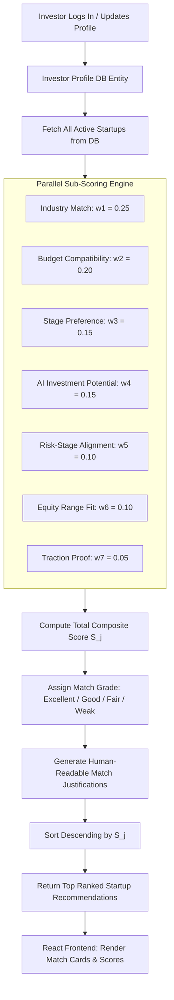

# Comprehensive Technical & Research Documentation: Investor–Startup Matching Module

---

## 1. Executive Summary & Module Overview

In modern venture capital ecosystems, startup discovery is historically plagued by information asymmetry, fragmented deal sourcing, and unstructured manual screening. Investors spend substantial time evaluating opportunities outside their sector focus, ticket size capacity, or risk appetite. Simultaneously, high-potential startups struggle to reach aligned capital providers.

The **Investor–Startup Matching Module** is a deterministic, multi-criteria recommendation and ranking subsystem designed for the **Startup_Investor** platform. It pairs investors with suitable early-stage ventures based on parametric investment preferences, financial constraints, and risk profiles.

### Crucial Architectural Distinction: Matching vs. ML Prediction

| Dimension | Module A: ML Investment Potential Prediction | Module B: Investor–Startup Matching Engine |
| :--- | :--- | :--- |
| **Primary Question** | *"Is this startup viable, creditworthy, and poised for growth?"* | *"Is this startup the right fit for this specific investor?"* |
| **Mathematical Nature** | Supervised Machine Learning Classification (Random Forest / XGBoost). | Multi-Criteria Decision Analysis (MCDA) via Weighted Scoring & Ranking. |
| **Input Feature Space** | Startup intrinsic data only: Financials (ARR, Burn, Runway), Unit Economics (CAC/LTV), Team Credentials, Market TAM. | Dyadic preference vectors: Investor criteria (budget, stage, sector, risk) $\times$ Startup offerings (ask, equity, stage, domain). |
| **Target / Output** | Probability distribution & tier: `HIGH_POTENTIAL`, `MODERATE_POTENTIAL`, `LOW_POTENTIAL`. | Relative Match Score $S(I_i, S_j) \in [0, 100]$, match grade, and personalized justification list. |
| **Role in Platform** | Objective Quality Filter & Due Diligence baseline. | Personalized Capital-Opportunity Matchmaker. |

### How Both Modules Synergize

The two modules operate in a staged pipeline:
1. **Stage 1 (Quality Gate - ML Model)**: Every startup is evaluated by the ML classification engine to compute its intrinsic `investmentPotentialScore` and tier.
2. **Stage 2 (Affinity Ranking - Matching Engine)**: When an investor logs in, the Matching Engine scores candidate startups against their preferences, using the ML potential score as a weighted dimension ($w_{\text{AI}} = 0.15$). This ensures investors are recommended startups that are **both** aligned with their preferences and fundamentally viable.

---

## 2. Investor Profile Taxonomy & Registration Schema

To optimize the matching algorithm without imposing friction during onboarding, investor data is segmented into **15 essential core fields** and optional operational parameters.

```
┌────────────────────────────────────────────────────────────────────────┐
│                      Investor Profile Data Model                       │
├──────────────────┬───────────────────┬─────────────────────────────────┤
│ Personal / Org   │ Financial Capital │ Preferences & Risk Strategy     │
├──────────────────┼───────────────────┼─────────────────────────────────┤
│ • Name & Email   │ • Total Budget    │ • Preferred Industries          │
│ • Investor Type  │ • Available Cap.  │ • Preferred Stages (IDEA, etc.) │
│ • Location       │ • Min Deal Size   │ • Equity Range (Min - Max %)    │
│ • Firm / Org     │ • Max Deal Size   │ • Risk Tolerance (Low/Med/High) │
│ • Experience Yrs │ • Horizon (Years) │ • Investment Strategy & Models  │
└──────────────────┴───────────────────┴─────────────────────────────────┘
```

### 2.1 The 15 Essential Onboarding Fields

| No. | Field Name | Java / DB Property | Type | Description |
| :---: | :--- | :--- | :--- | :--- |
| **1** | Investor Name | `user.name` | `VARCHAR(255)` | Full legal name of the angel/representative. |
| **2** | Email Address | `user.email` | `VARCHAR(255)` | Verified authentication email. |
| **3** | Location | `investorProfile.location` | `VARCHAR(255)` | Base city/country (e.g., "India", "Bengaluru"). |
| **4** | Investor Type | `investorProfile.investorType` | `VARCHAR(50)` | Individual, Angel, Venture Capital, Family Office. |
| **5** | Organization Name | `investorProfile.firmName` | `VARCHAR(255)` | Entity name or investment syndicate. |
| **6** | Total Investment Budget | `totalInvestmentBudget` | `DOUBLE` | Cumulative allocation capital across all deals. |
| **7** | Available Capital | `availableCapital` | `DOUBLE` | Liquid cash currently ready for immediate deployment. |
| **8** | Min Investment Per Deal | `minInvestmentSize` | `DOUBLE` | Smallest check size the investor writes. |
| **9** | Max Investment Per Deal | `maxInvestmentSize` | `DOUBLE` | Highest single-ticket limit per startup. |
| **10** | Preferred Industries | `investmentFocus` | `VARCHAR(500)` | Comma-separated sectors (e.g., "FinTech,AI/ML"). |
| **11** | Preferred Startup Stages | `preferredStages` | `VARCHAR(255)` | Comma-separated stages (e.g., "IDEA,MVP,GROWTH"). |
| **12** | Preferred Business Models | `preferredBusinessModels` | `VARCHAR(255)` | B2B SaaS, Marketplace, D2C Subscription, etc. |
| **13** | Preferred Equity Range | `preferredEquityMin` / `Max` | `DOUBLE` | Desired ownership percentage bounds (e.g., 5%–20%). |
| **14** | Risk Tolerance | `riskTolerance` | `VARCHAR(50)` | `Low`, `Medium`, or `High`. |
| **15** | Investment Horizon | `investmentHorizon` | `VARCHAR(50)` | Expected duration to liquidity (e.g., "3-5 years"). |

---

## 3. Mathematical Formulation of the Matching Engine

Let an investor profile be defined by tuple:
$$\mathcal{I} = \langle \mathcal{D}_I, [B_{\min}, B_{\max}], C_{\text{avail}}, \mathcal{S}_I, [E_{\min}, E_{\max}], \mathcal{R}_I, \mathcal{L}_I \rangle$$

Let a candidate startup profile be defined by:
$$\mathcal{S}_j = \langle D_j, F_j, S_j, E_j, \mathcal{P}_j, T_j \rangle$$
where $D_j$ is sector, $F_j$ is funding ask, $S_j$ is development stage, $E_j$ is equity offered, $\mathcal{P}_j$ is the ML investment potential score, and $T_j$ is operational traction.

The overall affinity score $S(\mathcal{I}, \mathcal{S}_j)$ is formulated as a normalized **Multi-Attribute Utility Function**:

$$S(\mathcal{I}, \mathcal{S}_j) = \sum_{k=1}^{7} w_k \cdot \sigma_k(\mathcal{I}, \mathcal{S}_j), \quad \text{subject to } \sum_{k=1}^{7} w_k = 1.0, \quad \sigma_k \in [0, 100]$$

### 3.1 Feature Weighting Distribution

| Dimension | Metric Symbol | Weight ($w_k$) | Rationale |
| :--- | :---: | :---: | :--- |
| **1. Industry / Sector Alignment** | $\sigma_{\text{ind}}$ | **$0.25$** | Primary mandate constraint; VCs cannot invest outside chartered sectors. |
| **2. Budget & Ticket Size Fit** | $\sigma_{\text{budget}}$ | **$0.20$** | Prevents mismatched check sizes (too large for angel or too small for fund). |
| **3. Stage Preference Alignment** | $\sigma_{\text{stage}}$ | **$0.15$** | Matches operational maturity with investor due-diligence capabilities. |
| **4. AI Investment Potential** | $\sigma_{\text{AI}}$ | **$0.15$** | Incorporates objective viability score computed by Random Forest/XGBoost. |
| **5. Risk-Stage Compatibility** | $\sigma_{\text{risk}}$ | **$0.10$** | Ensures risk tolerance correlates with startup volatility. |
| **6. Equity Dilution Fit** | $\sigma_{\text{equity}}$ | **$0.10$** | Ensures ownership target aligns with founder's cap table dilution. |
| **7. Traction & Funding Proof** | $\sigma_{\text{trac}}$ | **$0.05$** | Bonus reward for verified revenue generation and existing coinvestors. |

---

### 3.2 Dimension-Specific Scoring Functions

#### Dimension 1: Industry Alignment ($\sigma_{\text{ind}}$)
Let $\mathcal{D}_I$ be the set of investor focus sectors and $D_j$ be the startup sector:
$$\sigma_{\text{ind}}(\mathcal{I}, \mathcal{S}_j) = \begin{cases} 
100.0 & \text{if } D_j \in \mathcal{D}_I \text{ or } \text{PartialSubString}(D_j, \mathcal{D}_I) \\
20.0 & \text{otherwise (general cross-domain discovery baseline)}
\end{cases}$$

#### Dimension 2: Budget & Ticket Size Compatibility ($\sigma_{\text{budget}}$)
Let $F_j$ be the startup's funding requirement, and $[B_{\min}, B_{\max}]$ be the investor's single-deal check limits:
$$\sigma_{\text{budget}}(\mathcal{I}, \mathcal{S}_j) = \begin{cases} 
100.0 & \text{if } B_{\min} \le F_j \le B_{\max} \\
\max\left(10.0, \; \frac{F_j}{B_{\min}} \times 100\right) & \text{if } F_j < B_{\min} \quad (\text{ticket too small}) \\
\max\left(10.0, \; \frac{B_{\max}}{F_j} \times 100\right) & \text{if } F_j > B_{\max} \quad (\text{ticket too large / co-investment needed})
\end{cases}$$

#### Dimension 3: Business Stage Preference ($\sigma_{\text{stage}}$)
Let $\mathcal{S}_I \subseteq \{\text{IDEA}, \text{MVP}, \text{GROWTH}, \text{SCALING}\}$:
$$\sigma_{\text{stage}}(\mathcal{I}, \mathcal{S}_j) = \begin{cases} 
100.0 & \text{if } S_j \in \mathcal{S}_I \\
15.0 & \text{otherwise}
\end{cases}$$

#### Dimension 4: Equity Dilution Fit ($\sigma_{\text{equity}}$)
Let $E_j^{\text{for\_sale}} = 100.0 - \text{availableEquity}_j$, and $[E_{\min}, E_{\max}]$ be the investor's preferred ownership target:
$$\sigma_{\text{equity}}(\mathcal{I}, \mathcal{S}_j) = \begin{cases} 
100.0 & \text{if } E_{\min} \le E_j^{\text{for\_sale}} \le E_{\max} \\
\max\left(10.0, \; \frac{E_j^{\text{for\_sale}}}{E_{\min}} \times 100\right) & \text{if } E_j^{\text{for\_sale}} < E_{\min} \\
\max\left(10.0, \; \frac{E_{\max}}{E_j^{\text{for\_sale}}} \times 80\right) & \text{if } E_j^{\text{for\_sale}} > E_{\max}
\end{cases}$$

#### Dimension 5: Risk-Stage Compatibility Matrix ($\sigma_{\text{risk}}$)
Risk tolerance maps dynamically onto failure volatility by stage:

| Investor Risk Tolerance | `IDEA` Stage | `MVP` Stage | `GROWTH` Stage | `SCALING` Stage |
| :--- | :---: | :---: | :---: | :---: |
| **High** (Seed / Angel) | $100.0$ | $100.0$ | $70.0$ | $70.0$ |
| **Medium** (Balanced) | $40.0$ | $100.0$ | $100.0$ | $70.0$ |
| **Low** (Conservative / Private Equity) | $20.0$ | $40.0$ | $70.0$ | $100.0$ |

#### Dimension 6: AI Investment Potential Integration ($\sigma_{\text{AI}}$)
Incorporates the output from the Machine Learning classification pipeline (`Startup.investmentPotentialScore`):
$$\sigma_{\text{AI}}(\mathcal{S}_j) = \begin{cases} 
\text{investmentPotentialScore}_j & \text{if explicitly cached } \in [0, 100] \\
85.0 & \text{if } \text{Tier}_j = \text{HIGH\_POTENTIAL} \\
55.0 & \text{if } \text{Tier}_j = \text{MODERATE\_POTENTIAL} \\
20.0 & \text{if } \text{Tier}_j = \text{LOW\_POTENTIAL}
\end{cases}$$

#### Dimension 7: Traction & Social Proof ($\sigma_{\text{trac}}$)
$$\sigma_{\text{trac}}(\mathcal{S}_j) = 30.0 + 25.0 \cdot \mathbb{I}(F_{\text{prior}} > 0) + 25.0 \cdot \mathbb{I}(R_{\text{annual}} > 0) + 10.0 \cdot \mathbb{I}(\text{hasMentor}) + 10.0 \cdot \mathbb{I}(g_{\text{annual}} > 20\%)$$

---

## 4. End-to-End Matching Workflow & Architecture



---

## 5. Walkthrough of a Real-World Matching Scenario

### Scenario Input Data

#### Investor: *Vikram Sharma (Angel Syndicate)*
* **Focus**: `FinTech, AI/ML`
* **Budget Limits**: Min check: $\$50,000$, Max check: $\$300,000$
* **Preferred Stages**: `MVP, GROWTH`
* **Risk Tolerance**: `Medium`
* **Preferred Equity Range**: $8\% - 18\%$

#### Candidate Startup A: *PayPulse Analytics*
* **Sector**: `FinTech`
* **Stage**: `GROWTH`
* **Funding Goal**: `$200,000`
* **Equity Offered**: $12\%$
* **ML Potential Tier**: `HIGH_POTENTIAL` (Score: $88\%$)
* **Traction**: $\$140\text{k}$ ARR, Mentor assigned

#### Candidate Startup B: *BioAgri Labs*
* **Sector**: `Agriculture`
* **Stage**: `IDEA`
* **Funding Goal**: `$1,500,000`
* **Equity Offered**: $5\%$
* **ML Potential Tier**: `LOW_POTENTIAL` (Score: $28\%$)
* **Traction**: $\$0$ ARR, No mentor

---

### Step-by-Step Scoring Calculation

#### Evaluating Startup A (*PayPulse Analytics*):
1. **Industry**: `FinTech` matches `FinTech, AI/ML` $\to \sigma_{\text{ind}} = 100.0 \times 0.25 = \mathbf{25.0}$
2. **Budget**: $\$200\text{k}$ is within $[\$50\text{k}, \$300\text{k}] \to \sigma_{\text{budget}} = 100.0 \times 0.20 = \mathbf{20.0}$
3. **Stage**: `GROWTH` is within `[MVP, GROWTH]` $\to \sigma_{\text{stage}} = 100.0 \times 0.15 = \mathbf{15.0}$
4. **AI Score**: Score is $88.0 \to \sigma_{\text{AI}} = 88.0 \times 0.15 = \mathbf{13.2}$
5. **Risk Alignment**: Medium Risk + GROWTH stage $\to \sigma_{\text{risk}} = 100.0 \times 0.10 = \mathbf{10.0}$
6. **Equity Fit**: $12\%$ is within $[8\%, 18\%] \to \sigma_{\text{equity}} = 100.0 \times 0.10 = \mathbf{10.0}$
7. **Traction Proof**: Base ($30$) + Revenue ($25$) + Mentor ($10$) = $65.0 \to \sigma_{\text{trac}} = 65.0 \times 0.05 = \mathbf{3.25}$

$$\text{Total Score for Startup A} = 25.0 + 20.0 + 15.0 + 13.2 + 10.0 + 10.0 + 3.25 = \mathbf{96.45\%}$$
* **Result**: **EXCELLENT MATCH (96.5%)**  
* **System Reason**: *"Industry match: FinTech; Funding ask within budget; Stage match: GROWTH; AI predicts HIGH potential."*

---

#### Evaluating Startup B (*BioAgri Labs*):
1. **Industry**: `Agriculture` not in `FinTech, AI/ML` $\to \sigma_{\text{ind}} = 20.0 \times 0.25 = \mathbf{5.0}$
2. **Budget**: $\$1.5\text{M} > \$300\text{k}$ upper limit $\to \sigma_{\text{budget}} = \frac{300000}{1500000} \times 100 = 20.0 \times 0.20 = \mathbf{4.0}$
3. **Stage**: `IDEA` not in `[MVP, GROWTH]` $\to \sigma_{\text{stage}} = 15.0 \times 0.15 = \mathbf{2.25}$
4. **AI Score**: Score is $28.0 \to \sigma_{\text{AI}} = 28.0 \times 0.15 = \mathbf{4.2}$
5. **Risk Alignment**: Medium Risk + IDEA stage $\to \sigma_{\text{risk}} = 40.0 \times 0.10 = \mathbf{4.0}$
6. **Equity Fit**: $5\% < 8\%$ lower limit $\to \sigma_{\text{equity}} = \frac{5}{8} \times 100 = 62.5 \times 0.10 = \mathbf{6.25}$
7. **Traction Proof**: Base only = $30.0 \times 0.05 = \mathbf{1.5}$

$$\text{Total Score for Startup B} = 5.0 + 4.0 + 2.25 + 4.2 + 4.0 + 6.25 + 1.5 = \mathbf{27.2\%}$$
* **Result**: **WEAK MATCH (27.2%)** (Ranked at the bottom of the investor's feed).

---

## 6. Database Requirements & SQL Schema

The matching module utilizes the updated `InvestorProfile` table in MySQL / H2:

```sql
CREATE TABLE investor_profile (
    id BIGINT AUTO_INCREMENT PRIMARY KEY,
    user_id BIGINT UNIQUE NOT NULL,
    firm_name VARCHAR(255),
    investor_type VARCHAR(50) DEFAULT 'Individual',
    location VARCHAR(255),
    
    -- Financial Check Sizes
    total_investment_budget DOUBLE DEFAULT 0.0,
    available_capital DOUBLE DEFAULT 0.0,
    min_investment_size DOUBLE,
    max_investment_size DOUBLE,
    
    -- Preferences
    investment_focus VARCHAR(500),          -- Comma-separated sectors
    preferred_stages VARCHAR(255),          -- Comma-separated stages
    preferred_business_models VARCHAR(255),  -- e.g. B2B SaaS
    preferred_locations VARCHAR(255),
    
    -- Risk & Return Strategy
    risk_tolerance VARCHAR(50) DEFAULT 'Medium',
    investment_strategy VARCHAR(50) DEFAULT 'Balanced',
    preferred_equity_min DOUBLE DEFAULT 5.0,
    preferred_equity_max DOUBLE DEFAULT 25.0,
    investment_horizon VARCHAR(50) DEFAULT '3-5 years',
    
    -- Track Record
    previous_investment_count INT DEFAULT 0,
    successful_investments INT DEFAULT 0,
    investment_experience VARCHAR(50) DEFAULT 'Intermediate',
    expected_return_percentage DOUBLE DEFAULT 0.0,
    bio TEXT,
    
    CONSTRAINT fk_investor_user FOREIGN KEY (user_id) REFERENCES user(id) ON DELETE CASCADE
);
```

---

## 7. API Input and Output Specifications

### Endpoint: Fetch Recommended Startups for an Investor
* **URL**: `GET /api/investor-profiles/user/{userId}/matching-startups`
* **Authorization**: Bearer JWT (`ROLE_INVESTOR` or `ROLE_ADMIN`)

#### Sample JSON Response:
```json
[
  {
    "startupId": 1,
    "startupName": "PayPulse Analytics",
    "sector": "FinTech",
    "stage": "GROWTH",
    "fundingGoal": 200000.0,
    "availableEquity": 88.0,
    "companyValuation": 5000000.0,
    "investmentPotentialTier": "HIGH_POTENTIAL",
    "investmentPotentialScore": 88.0,
    "matchScore": 96.45,
    "matchGrade": "EXCELLENT_MATCH",
    "matchReasons": [
      "Industry match: FinTech aligns with your focus",
      "Funding goal within your investment range",
      "Stage preference match: GROWTH",
      "AI predicts HIGH investment potential"
    ],
    "founderId": 3,
    "founderName": "Jane Doe"
  }
]
```

---

## 8. Summary of Research Contribution

1. **Separation of Concerns**: Clearly isolates intrinsic startup due diligence (ML model) from relational capital-opportunity compatibility (Weighted Matching MCDA).
2. **Explainable Recommendations**: Rather than offering unexplainable rankings, every match score provides human-readable verification points (*"Why was this startup recommended?"*), elevating investor trust.
3. **Dual Gate Architecture**: Prevents low-quality, high-risk startups from being elevated purely because they meet stage or sector preferences by actively checking the AI predictive viability score.
