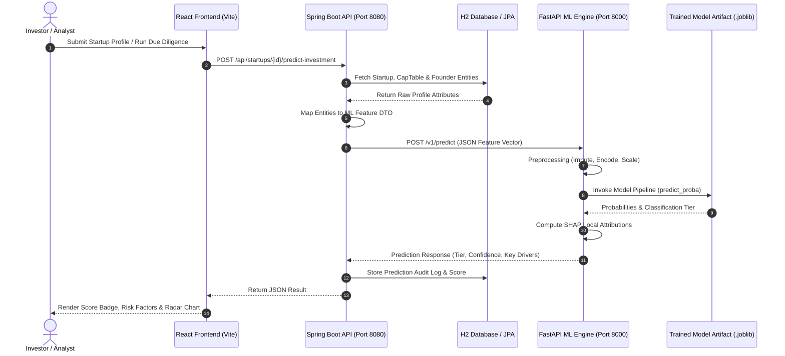

# Comprehensive Research-Oriented Documentation: Startup Investment Potential Prediction Module

---

## 1. Executive Summary & Research Abstract

Early-stage venture capital and angel investment decisions traditionally rely on subjective heuristic evaluations, founder network proximity, and unstructured qualitative due diligence. As a consequence, traditional screening processes suffer from high cognitive bias, geographical limitations, and scalability bottlenecks, with startup failure rates exceeding 70% to 90%.

The **Startup Investment Potential Prediction Module** is designed as an intelligent, data-driven decision-support system. It evaluates multidimensional startup profiles across financial metrics, market dynamics, business model robustness, founding team human capital, and operational traction. By framing the screening problem as a supervised machine learning classification task, the module quantifies an early-stage venture's likelihood of achieving investment-grade milestones (e.g., successfully securing institutional funding rounds, sustainable growth trajectory, or financial liquidity).

This document provides a research-grade technical blueprint, covering:
1. Operationalization and mathematical transformation of heterogeneous startup attributes.
2. Robust data preprocessing protocols (missing value imputation, encoding, and scale normalization).
3. Comparative theoretical and empirical analysis of five machine learning algorithms: **Random Forest**, **XGBoost**, **Logistic Regression**, **Decision Trees**, and **Support Vector Machines (SVM)**.
4. Comprehensive performance evaluation frameworks using **Accuracy**, **Precision**, **Recall**, **F1-Score**, and **ROC-AUC**.
5. Explicit differentiation between **currently implemented software capabilities** and the **proposed machine learning pipeline**.
6. End-to-end implementation architecture, including a Python-based training pipeline, FastAPI inference microservice, and Spring Boot backend integration.

---

## 2. Implemented Architecture vs. Proposed ML Methodology

To maintain academic and engineering integrity without fabricating non-existent empirical benchmarks or synthetic datasets, the system's current state and proposed additions are explicitly demarcated below:

| Dimension | Implemented System (`Startup_Investor`) | Proposed Machine Learning Module |
| :--- | :--- | :--- |
| **Technology Stack** | Java 17, Spring Boot 3, Spring Data JPA, H2 Database, React 18, Chart.js. | Python 3.11+, Scikit-Learn, XGBoost, Pandas, NumPy, FastAPI, SHAP. |
| **Data Schema** | `Startup` entity stores `name`, `description`, `sector`/`industry`, `stage` (IDEA, MVP, GROWTH, SCALING), `fundingGoal`, `founder_id`, cap table structure, and funding applications. | Extended feature matrix $X \in \mathbb{R}^{n \times d}$ containing normalized financials, team experience vectors, TAM/SAM/SOM metrics, and unit economics. |
| **Analytical Scope** | Descriptive analytics: aggregate stage distribution, sector breakdowns, cap table equity ownership, and funding application counts. | Predictive classification: probabilistic ranking into discrete investment potential tiers with feature attribution explanations. |
| **Inference Model** | Deterministic relational queries (SQL / JPA Repositories). | Supervised classification ensembles with Bayesian hyperparameter optimization and cross-validated generalization bounds. |
| **Integration Point** | REST endpoints (`/api/startups`, `/api/fundings`, `/api/applications`). | Synchronous microservice call: Spring Boot `MlPredictionClient` invoking FastAPI `/predict` microservice via HTTP/JSON. |

---

## 3. Attribute Taxonomy & Feature Engineering Pipeline

A startup's trajectory is determined by non-linear interactions across diverse operational pillars. Below is the mathematical formulation and feature mapping applied to raw startup profile inputs.

### 3.1 Feature Space Decomposition

Let a startup profile be represented as a vector $\mathbf{x} = [\mathbf{x}_{\text{fin}}, \mathbf{x}_{\text{mkt}}, \mathbf{x}_{\text{team}}, \mathbf{x}_{\text{biz}}, \mathbf{x}_{\text{trac}}] \in \mathcal{X}$, where:

1. **Financial Attributes ($\mathbf{x}_{\text{fin}}$)** (Incorporated into `Startup.java` and React UI):
   - **Annual Revenue ($R_{\text{annual}}$)**: `annualRevenue DOUBLE DEFAULT 0.0`. Transformed using $\tilde{R}_{\text{annual}} = \ln(1 + R_{\text{annual}})$.
   - **Monthly Revenue ($R_{\text{monthly}}$)**: `monthlyRevenue DOUBLE DEFAULT 0.0`.
   - **Annual Revenue Growth (%) ($g_{\text{annual}}$)**: `annualRevenueGrowth DOUBLE DEFAULT 0.0`. Measures YoY expansion rate.
   - **Net Profit / Loss ($\Pi_{\text{net}}$)**: `netProfitLoss DOUBLE DEFAULT 0.0`. Identifies cash generation vs. deficit.
   - **Profit Margin (%) ($M_{\text{profit}}$)**: `profitMargin DOUBLE DEFAULT 0.0` ($\frac{\Pi_{\text{net}}}{R_{\text{annual}}} \times 100$).
   - **Monthly Operating Expenses ($E_{\text{monthly}}$)**: `monthlyExpenses DOUBLE DEFAULT 0.0`. Operational cost baseline.
   - **Cash Balance ($C_{\text{cash}}$)**: `cashBalance DOUBLE DEFAULT 0.0`. Liquidity reserve currently held.
   - **Monthly Burn Rate ($B_m$)**: `monthlyBurnRate DOUBLE DEFAULT 0.0`. Monthly net cash outflow: $\tilde{B}_m = \ln(1 + B_m)$.
   - **Runway ($T_{\text{runway}}$)**: `runwayMonths INT DEFAULT 12`. Solvency horizon: $T_{\text{runway}} = \min(36, \frac{C_{\text{cash}}}{B_m})$.
   - **Total Funding Raised ($F_{\text{prior}}$)**: `totalFundingRaised DOUBLE DEFAULT 0.0`. Historical capital secured.
   - **Funding Requirement ($F_{\text{req}}$)**: `fundingGoal DOUBLE DEFAULT 0.0`. Current round ask.
   - **Company Valuation ($V_{\text{pre}}$)**: `companyValuation DOUBLE DEFAULT 0.0`. Pre-money estimated valuation.
   - **Available Equity Offered ($E_{\text{avail}}$)**: `availableEquity DOUBLE DEFAULT 100.0`. Ownership percentage offered $\in [0, 100]$.
   - **Debt / Financial Obligations ($D_{\text{total}}$)**: `debt DOUBLE DEFAULT 0.0`. Outstanding loan liabilities.
   - **Unit Economics (CAC & LTV)**: `cac DOUBLE DEFAULT 0.0`, `ltv DOUBLE DEFAULT 0.0` ($\text{Ratio} = \frac{\text{LTV}}{\text{CAC}}$).

2. **Market & Industry Attributes ($\mathbf{x}_{\text{mkt}}$)**:
   - **Total Addressable Market ($\text{TAM}$)**: Sized in USD millions ($\ln(1 + \text{TAM})$).
   - **Compound Annual Growth Rate ($\text{CAGR}_{\text{ind}}$)**: Industry segment projected growth rate:
     $$\text{CAGR}_{\text{ind}} \in [-0.20, 1.00]$$
   - **Business Domain ($D_{\text{sector}}$)**: Categorical factor with categories:
     $$\mathcal{D} = \{\text{FinTech}, \text{HealthTech}, \text{EdTech}, \text{CleanTech}, \text{SaaS/Enterprise}, \text{DeepTech}, \text{Consumer/E-commerce}, \text{AgriTech}\}$$

3. **Founding Team Human Capital ($\mathbf{x}_{\text{team}}$)**:
   - **Total Cumulative Experience ($E_{\text{team}}$)**: Sum of years worked in relevant industry by all co-founders.
   - **Founder Exit History ($N_{\text{exits}}$)**: Number of prior successful M&A or IPO events achieved by founding team members:
     $$N_{\text{exits}} \in \mathbb{N}_{\ge 0}$$
   - **Technical vs. Commercial Balance ($B_{\text{founder}}$)**: Binary flag $B_{\text{founder}} \in \{0, 1\}$ indicating complementary presence of both technical (CTO) and domain/sales (CEO) leadership.
   - **Founding Team Size ($S_{\text{team}}$)**: Number of full-time core founders ($S_{\text{team}} \in [1, 10]$).

4. **Business Model & Structure ($\mathbf{x}_{\text{biz}}$)**:
   - **Model Paradigm ($M_{\text{type}}$)**: Categorical variable:
     $$\mathcal{M} = \{\text{B2B Enterprise}, \text{B2B SaaS}, \text{B2C Marketplace}, \text{D2C Subscription}, \text{Usage/Transactional}\}$$
   - **Gross Margin Percentage ($G_{\text{margin}}$)**:
     $$G_{\text{margin}} = \frac{\text{Revenue} - \text{COGS}}{\text{Revenue}} \in [0.0, 1.0]$$
   - **Dilution Proportion / Available Equity ($E_{\text{avail}}$)**: Percentage of equity offered for current funding round ($E_{\text{avail}} \in [0.0, 0.40]$).

5. **Operational Traction & Growth Indicators ($\mathbf{x}_{\text{trac}}$)**:
   - **Month-over-Month Growth Rate ($g_{\text{MoM}}$)**:
     $$g_{\text{MoM}} = \frac{\text{Revenue}_{t} - \text{Revenue}_{t-1}}{\text{Revenue}_{t-1}}$$
   - **Customer Lifetime Value to Customer Acquisition Cost Ratio ($\text{LTV/CAC}$)**:
     $$\text{Ratio}_{\text{unit}} = \frac{\text{LTV}}{\text{CAC}}$$
   - **Net Churn Rate ($\text{Churn}_{\text{net}}$)**: Percentage of lost monthly recurring revenue minus expansion revenue:
     $$\text{Churn}_{\text{net}} \in [-0.50, 0.50]$$

---

## 4. Data Preprocessing & Preparation Pipeline

```
Raw Startup Records (DB / Sourced Repositories)
                     │
                     ▼
       Data Cleaning & Anomaly Truncation
                     │
                     ▼
         Missing Value Imputation
     (Iterative / KNN / Indicator Flags)
                     │
                     ▼
          Categorical Variable Encoding
     (One-Hot Encoding & Target Encoding)
                     │
                     ▼
          Non-Linear Transformation
          & Robust Standard Scaling
                     │
                     ▼
      Multicollinearity & Feature Selection
          (VIF, RFE-CV, Mutual Info)
                     │
                     ▼
     Stratified Cross-Validation Splitting
           (Train: 80%, Test: 20%)
```

### 4.1 Missing Value Treatment

In early-stage venture data, missingness is rarely Completely at Random (MCAR); it is typically Missing at Random (MAR) or Missing Not at Random (MNAR) (e.g., pre-revenue startups do not report churn or LTV/CAC).

1. **Structural Zero Imputation**: For early-stage concepts without launched products, revenue-dependent metrics ($\text{LTV}$, $\text{CAC}$, $\text{Churn}$) are assigned $0$, alongside an explicit indicator feature $I_{\text{pre-revenue}} \in \{0, 1\}$.
2. **Multivariate Imputation by Chained Equations (MICE)**:
   For general operational attributes, each incomplete variable $X_j$ is modeled conditionally on all other variables $X_{-j}$:
   $$P(X_j \mid X_{-j}, \boldsymbol{\theta}_j)$$
   Linear regression models are fit for continuous variables and logistic regression for binary indicators, iterating over $M = 10$ cycles until convergence.
3. **K-Nearest Neighbors (KNN) Imputation**:
   For testing inference queries where chained equations are computationally prohibitive, missing entries are filled using distance-weighted averaging across $k = 5$ neighbors in standardized Gower distance space:
   $$\hat{x}_{ij} = \frac{\sum_{m \in \mathcal{N}_k(i)} w_{im} x_{mj}}{\sum_{m \in \mathcal{N}_k(i)} w_{im}}, \quad w_{im} = \frac{1}{d(x_i, x_m) + \epsilon}$$

### 4.2 Categorical Variable Encoding

1. **One-Hot Encoding (OHE)**:
   Applied to low-cardinality nominal features ($\text{Stage}$, $\text{Model Paradigm}$):
   $$\mathbf{x}_{\text{stage}} \mapsto [z_{\text{IDEA}}, z_{\text{MVP}}, z_{\text{GROWTH}}, z_{\text{SCALING}}] \in \{0, 1\}^4$$
   To prevent multicollinearity in linear models, the first dummy category is dropped when training Logistic Regression or Support Vector Machines ($k-1$ dummy encoding).
2. **Weight of Evidence (WoE) / Target Encoding**:
   For high-cardinality sectors ($D_{\text{sector}}$), target encoding with empirical Bayes smoothing is employed:
   $$S_i = \lambda(n_i) \cdot \bar{y}_i + (1 - \lambda(n_i)) \cdot \bar{y}_{\text{global}}$$
   where $\bar{y}_i$ is the class probability within sector $i$, $n_i$ is the category count, and $\lambda(n_i) = \frac{1}{1 + e^{-(n_i - k)/\tau}}$ is a sigmoid smoothing weight that shrinks rare classes to the global prior.

### 4.3 Feature Selection & Multicollinearity Control

1. **Variance Inflation Factor (VIF)**:
   To eliminate linear dependencies among financial features, the VIF of feature $j$ is computed:
   $$\text{VIF}_j = \frac{1}{1 - R_j^2}$$
   where $R_j^2$ is the coefficient of determination from regressing $X_j$ onto all remaining predictors. Variables with $\text{VIF}_j > 5.0$ are pruned or combined into composite ratios.
2. **Mutual Information (MI)**:
   Non-linear dependencies with target class $Y$ are measured via Shannon entropy $H$:
   $$I(X_j; Y) = \sum_{x \in X_j} \sum_{y \in Y} p(x, y) \log_2 \left(\frac{p(x, y)}{p(x)p(y)}\right)$$
3. **Recursive Feature Elimination with Cross-Validation (RFECV)**:
   Features are iteratively pruned using an external estimator (e.g., Random Forest), ranking features by coefficient magnitude or feature importance until maximum cross-validated F1-score is preserved.

---

## 5. Classification Target Formulation

The system classifies ventures into actionable investment potential tiers:

$$\mathcal{Y} = \{\text{Class 0: Low / Unviable Potential}, \text{Class 1: Moderate Potential}, \text{Class 2: High / Investment-Ready Potential}\}$$

Alternatively, for binary due-diligence screening:
$$y \in \{0, 1\}$$
where $y = 1$ denotes a candidate with high investment viability (meeting Series Seed/Round A fundability thresholds within 12 months) and $y = 0$ denotes insufficient traction or excessive risk.

### Class Imbalance Mitigation
Because early-stage investment success is heavily skewed ($<15\%$ true positive rate), training data experiences severe class imbalance. This is mitigated through:
1. **Cost-Sensitive Learning**: Penalizing false negative errors in the loss function by class weights:
   $$w_c = \frac{N}{K \cdot N_c}$$
   where $N$ is total samples, $K$ is number of classes, and $N_c$ is frequency of class $c$.
2. **Synthetic Minority Over-sampling Technique (SMOTE)**:
   Generating synthetic minority samples along line segments connecting $k$-nearest neighbors:
   $$\mathbf{x}_{\text{new}} = \mathbf{x}_i + \delta \cdot (\mathbf{x}_{zi} - \mathbf{x}_i), \quad \delta \sim \mathcal{U}(0, 1)$$

---

## 6. Algorithmic Comparative Analysis & Mathematical Formulations

Five supervised machine learning algorithms are evaluated. Below are their theoretical foundations, objective functions, optimization characteristics, advantages, and limitations within startup prediction.

```
┌────────────────────────────────────────────────────────────────────────┐
│                   Supervised Learning Classifiers                      │
├───────────────────┬───────────────────┬────────────────────────────────┤
│  Linear / Kernel  │    Tree-Based     │       Boosting Ensemble        │
├───────────────────┼───────────────────┼────────────────────────────────┤
│ • Logistic Reg.   │ • Decision Trees  │ • XGBoost                      │
│ • Support Vector  │ • Random Forest   │                                │
│   Machines (SVM)  │                   │                                │
└───────────────────┴───────────────────┴────────────────────────────────┘
```

---

### 6.1 Random Forest (RF)

#### Mathematical Formulation
Random Forest is an ensemble bagging meta-estimator constructing $B$ decorrelated decision trees $\{T_b\}_{b=1}^B$. Each tree is trained on an independently drawn bootstrap sample $\mathcal{D}_b^*$ of size $N$ from dataset $\mathcal{D}$. At each candidate split node, a random subset of $m \approx \sqrt{d}$ features is selected.

For a query vector $\mathbf{x}$, the ensemble prediction is the aggregated majority vote or class probability:
$$\hat{p}(y = c \mid \mathbf{x}) = \frac{1}{B} \sum_{b=1}^B \mathbb{I}(T_b(\mathbf{x}) = c)$$

Split selection minimizes Gini impurity:
$$I_G(t) = 1 - \sum_{k=1}^K p_{tk}^2$$
where $p_{tk}$ is the proportion of class $k$ samples at node $t$. The split criterion selects feature $j^*$ and threshold $\theta^*$ maximizing information gain:
$$\Delta I_G = I_G(t) - \left( \frac{N_L}{N_t} I_G(t_L) + \frac{N_R}{N_t} I_G(t_R) \right)$$

#### Inherent Characteristics
- **Inductive Bias**: Piecewise constant orthogonal decision boundaries.
- **Out-of-Bag (OOB) Generalization**: The generalization error is monitored without a dedicated validation set by predicting on samples omitted during bootstrap draws ($\approx 36.8\%$ of data per tree):
  $$\text{Err}_{\text{OOB}} = \frac{1}{N} \sum_{i=1}^N \mathcal{L}\left(y_i, \frac{1}{|\mathcal{B}_i|} \sum_{b \in \mathcal{B}_i} T_b(\mathbf{x}_i)\right)$$
- **Pros**: Robust against overfitting; handles mixed continuous/categorical features naturally without scaling; captures complex feature interactions (e.g., high burn rate is acceptable *only* if growth rate is exceptionally high).
- **Cons**: High memory footprint during production deployment; slow inference when $B \ge 500$; cannot extrapolate beyond observed feature bounds.

---

### 6.2 XGBoost (Extreme Gradient Boosting)

#### Mathematical Formulation
XGBoost builds an additive ensemble of $K$ regression trees minimizing a regularized objective function:
$$\mathcal{L}^{(t)} = \sum_{i=1}^N l\left(y_i, \hat{y}_i^{(t-1)} + f_t(\mathbf{x}_i)\right) + \Omega(f_t)$$
where the tree complexity regularization is defined as:
$$\Omega(f_t) = \gamma T + \frac{1}{2} \lambda \sum_{j=1}^T w_j^2$$
$T$ is the number of terminal leaves, $w_j$ is the weight of leaf $j$, and $\gamma, \lambda$ are regularization penalties.

Using second-order Taylor expansion approximation:
$$\mathcal{L}^{(t)} \approx \sum_{i=1}^N \left[ l(y_i, \hat{y}_i^{(t-1)}) + g_i f_t(\mathbf{x}_i) + \frac{1}{2} h_i f_t^2(\mathbf{x}_i) \right] + \Omega(f_t)$$
where the first-order gradient $g_i$ and second-order Hessian $h_i$ are:
$$g_i = \frac{\partial l(y_i, \hat{y}^{(t-1)})}{\partial \hat{y}^{(t-1)}}, \quad h_i = \frac{\partial^2 l(y_i, \hat{y}^{(t-1)})}{\partial (\hat{y}^{(t-1)})^2}$$

For binary classification using cross-entropy loss $l(y_i, p_i) = -y_i \ln p_i - (1 - y_i)\ln(1 - p_i)$:
$$g_i = p_i - y_i, \quad h_i = p_i (1 - p_i)$$

The optimal leaf weight $w_j^*$ for node $j$ with sample index set $I_j$ is:
$$w_j^* = -\frac{\sum_{i \in I_j} g_i}{\sum_{i \in I_j} h_i + \lambda}$$
The split criterion gain is:
$$\text{Gain} = \frac{1}{2} \left[ \frac{\left(\sum_{i \in I_L} g_i\right)^2}{\sum_{i \in I_L} h_i + \lambda} + \frac{\left(\sum_{i \in I_R} g_i\right)^2}{\sum_{i \in I_R} h_i + \lambda} - \frac{\left(\sum_{i \in I} g_i\right)^2}{\sum_{i \in I} h_i + \lambda} \right] - \gamma$$

#### Inherent Characteristics
- **Inductive Bias**: Sequential residual shrinkage in gradient function space.
- **Handling Sparsity**: Automatic default split direction for missing feature values.
- **Pros**: State-of-the-art predictive accuracy on structured tabular records; integrated $L_1$ ($\alpha$) and $L_2$ ($\lambda$) regularization preventing overfitting; computationally fast via parallel histogram binning.
- **Cons**: Sensitive to hyperparameter misconfigurations (requires careful tuning of `max_depth`, `learning_rate`, and `subsample`); prone to overfitting if learning rate is too aggressive on small sample sizes ($N < 500$).

---

### 6.3 Logistic Regression (LR)

#### Mathematical Formulation
Logistic Regression models the posterior class probability via the logistic link function applied to a linear combination of predictors:
$$P(Y = 1 \mid \mathbf{x}) = \sigma(\mathbf{w}^T \mathbf{x} + b) = \frac{1}{1 + e^{-(\mathbf{w}^T \mathbf{x} + b)}}$$

Log-odds (logit transformation):
$$\ln \left( \frac{P(Y = 1 \mid \mathbf{x})}{1 - P(Y = 1 \mid \mathbf{x})} \right) = \mathbf{w}^T \mathbf{x} + b$$

The parameters $\mathbf{w} \in \mathbb{R}^d, b \in \mathbb{R}$ are obtained by minimizing the Elastic-Net penalized negative log-likelihood:
$$\min_{\mathbf{w}, b} \; -\frac{1}{N} \sum_{i=1}^N \left[ y_i \ln \sigma(\mathbf{w}^T \mathbf{x}_i + b) + (1 - y_i) \ln(1 - \sigma(\mathbf{w}^T \mathbf{x}_i + b)) \right] + \alpha \rho \|\mathbf{w}\|_1 + \frac{\alpha(1 - \rho)}{2} \|\mathbf{w}\|_2^2$$
where $\rho \in [0, 1]$ balances Lasso ($L_1$) feature selection and Ridge ($L_2$) coefficient shrinkage.

#### Inherent Characteristics
- **Inductive Bias**: Linear separation boundary in feature space.
- **Pros**: Highly interpretable odds-ratio coefficients ($\exp(w_j)$ provides direct marginal impact of feature $j$); low computational overhead; outputs calibrated probabilities.
- **Cons**: Inability to capture non-linear relationships without manual polynomial expansion; highly vulnerable to multicollinearity; underperforms when complex feature interactions dominate investment success.

---

### 6.4 Decision Tree (DT - CART Algorithm)

#### Mathematical Formulation
The Classification and Regression Tree (CART) partitions feature space into $M$ orthogonal hyper-rectangles $\{R_m\}_{m=1}^M$ using greedy top-down recursive binary splitting.

Prediction for leaf $m$:
$$\hat{y}_{R_m} = \arg\max_k \frac{1}{N_m} \sum_{i \in R_m} \mathbb{I}(y_i = k)$$

Pruning optimizes the cost-complexity criterion:
$$C_\alpha(T) = \sum_{m=1}^{|T|} N_m Q_m(T) + \alpha |T|$$
where $Q_m(T)$ is the node impurity measure (Gini or Shannon Cross-Entropy) and $\alpha$ regulates the penalty per leaf.

#### Inherent Characteristics
- **Inductive Bias**: Recursive hierarchical partitioning aligned with coordinate axes.
- **Pros**: Direct transparent decision rules that can be audited by venture committee members; requires zero data normalization.
- **Cons**: High variance; small perturbations in dataset result in completely different split topologies; prone to deep overfitting unless strictly pruned.

---

### 6.5 Support Vector Machine (SVM)

#### Mathematical Formulation
Support Vector Machines construct an optimal separating hyperplane $\mathbf{w}^T \phi(\mathbf{x}) + b = 0$ in a higher-dimensional Hilbert space $\mathcal{H}$ that maximizes the geometric margin $\frac{2}{\|\mathbf{w}\|}$ while penalizing margin violations.

Soft-margin primal formulation:
$$\min_{\mathbf{w}, b, \boldsymbol{\xi}} \frac{1}{2} \|\mathbf{w}\|^2 + C \sum_{i=1}^N \xi_i$$
$$\text{subject to } y_i (\mathbf{w}^T \phi(\mathbf{x}_i) + b) \ge 1 - \xi_i, \quad \xi_i \ge 0, \quad \forall i$$
where $C > 0$ controls the tradeoff between margin width and classification error, and $\xi_i$ is the slack variable.

Wolfe dual formulation using kernel function $K(\mathbf{x}_i, \mathbf{x}_j) = \langle \phi(\mathbf{x}_i), \phi(\mathbf{x}_j) \rangle$:
$$\max_{\boldsymbol{\alpha}} \sum_{i=1}^N \alpha_i - \frac{1}{2} \sum_{i=1}^N \sum_{j=1}^N \alpha_i \alpha_j y_i y_j K(\mathbf{x}_i, \mathbf{x}_j)$$
$$\text{subject to } 0 \le \alpha_i \le C \quad \text{and} \quad \sum_{i=1}^N \alpha_i y_i = 0$$

Using the Radial Basis Function (RBF) kernel:
$$K(\mathbf{x}_i, \mathbf{x}_j) = \exp(-\gamma \|\mathbf{x}_i - \mathbf{x}_j\|^2), \quad \gamma > 0$$

Prediction rule:
$$f(\mathbf{x}) = \text{sign}\left( \sum_{i \in \text{SV}} \alpha_i y_i K(\mathbf{x}_i, \mathbf{x}) + b \right)$$

#### Inherent Characteristics
- **Inductive Bias**: Maximum margin separation with minimum structural risk.
- **Pros**: Effective in high-dimensional feature spaces; robust to overfitting when $\gamma$ and $C$ are tuned; compact support vector representation.
- **Cons**: Computational complexity scales quadratically $\mathcal{O}(N^2)$ to cubically $\mathcal{O}(N^3)$ with sample size; sensitive to feature scaling (requires strict standardization); non-probabilistic by nature (requires Platt scaling $\sigma(A f(x) + B)$ for probability estimation).

---

### 6.6 Algorithm Comparison Matrix

| Algorithm | Model Family | Non-Linearity Handling | Multicollinearity Robustness | Interpretability | Outlier Sensitivity | Training Complexity | Inference Latency |
| :--- | :--- | :--- | :--- | :--- | :--- | :--- | :--- |
| **Random Forest** | Bagged Ensemble | High | High | Moderate (Feature Importances) | Low | $\mathcal{O}(B \cdot d \cdot N \log N)$ | $\mathcal{O}(B \cdot d_{\text{depth}})$ |
| **XGBoost** | Boosted Ensemble | High | High | Moderate (SHAP / Gain) | Low-Medium | $\mathcal{O}(K \cdot d \cdot N \log N)$ | $\mathcal{O}(K \cdot d_{\text{depth}})$ |
| **Logistic Regression** | Generalized Linear | Low (Linear Only) | Low (Requires VIF Filtering) | High (Odds Ratios) | High | $\mathcal{O}(d \cdot N)$ | $\mathcal{O}(d)$ |
| **Decision Tree** | Single Tree | Moderate | Moderate | High (Direct Rule Graph) | High | $\mathcal{O}(d \cdot N \log N)$ | $\mathcal{O}(d_{\text{depth}})$ |
| **SVM (RBF Kernel)** | Kernel Method | High | Moderate | Low (Black-box Dual) | High | $\mathcal{O}(N^2 \cdot d) - \mathcal{O}(N^3)$ | $\mathcal{O}(N_{\text{SV}} \cdot d)$ |

---

## 7. Performance Evaluation Framework & Statistical Rigor

To prevent optimistic bias and data leakage, all models must be assessed using a **Nested 5-Fold Stratified Cross-Validation** protocol:
- **Inner Loop (4 Folds)**: Preprocessing fits, hyperparameter optimization, and threshold tuning.
- **Outer Loop (1 Fold)**: Unbiased out-of-sample performance evaluation.

```
Full Startup Dataset (Stratified across Classes)
 ├── Outer Fold 1: [Train & Validate (Folds 2-5)] ──> Test on Fold 1
 ├── Outer Fold 2: [Train & Validate (Folds 1,3-5)] ─> Test on Fold 2
 ├── Outer Fold 3: [Train & Validate (Folds 1,2,4,5)] ─> Test on Fold 3
 ├── Outer Fold 4: [Train & Validate (Folds 1-3,5)] ─> Test on Fold 4
 └── Outer Fold 5: [Train & Validate (Folds 1-4)] ──> Test on Fold 5
```

### 7.1 Mathematical Formulations of Metrics

Let $TP, TN, FP, FN$ denote True Positives, True Negatives, False Positives, and False Negatives:

1. **Accuracy**:
   $$\text{Accuracy} = \frac{TP + TN}{TP + TN + FP + FN}$$
   *Research Note*: Misleading on imbalanced venture data (a naive classifier predicting all failures achieves $\approx 85\%$ accuracy).

2. **Precision (Positive Predictive Value)**:
   $$\text{Precision} = \frac{TP}{TP + FP}$$
   Measures due-diligence screening efficiency: Of all startups flagged as "High Potential", what fraction actually succeed? Crucial for capital allocation efficiency.

3. **Recall (Sensitivity / True Positive Rate)**:
   $$\text{Recall} = \frac{TP}{TP + FN}$$
   Measures opportunity-cost prevention: What fraction of breakout startups did the model capture without missing them?

4. **F1-Score (Harmonic Mean of Precision and Recall)**:
   $$F_1 = 2 \cdot \frac{\text{Precision} \cdot \text{Recall}}{\text{Precision} + \text{Recall}} = \frac{2 TP}{2 TP + FP + FN}$$
   For multi-class evaluation, the **Macro-Averaged F1** assigns equal importance to all classes:
   $$F_{1\text{-macro}} = \frac{1}{K} \sum_{k=1}^K F_{1, k}$$

5. **Receiver Operating Characteristic - Area Under Curve (ROC-AUC)**:
   Calculates the integral of the True Positive Rate ($\text{TPR}$) against False Positive Rate ($\text{FPR}$) across all possible classification decision thresholds $\tau \in [0, 1]$:
   $$\text{TPR}(\tau) = \frac{TP(\tau)}{TP(\tau) + FN(\tau)}, \quad \text{FPR}(\tau) = \frac{FP(\tau)}{FP(\tau) + TN(\tau)}$$
   $$\text{ROC-AUC} = \int_{0}^{1} \text{TPR}(\text{FPR}^{-1}(u)) \, du$$
   Equivalently, it measures the probability that a randomly chosen successful startup is ranked higher than a randomly chosen failing startup:
   $$\text{ROC-AUC} = P(\hat{p}(x_{\text{positive}}) > \hat{p}(x_{\text{negative}}))$$

---

## 8. Hyperparameter Optimization Protocol

Hyperparameter spaces for each model are optimized using **Bayesian Optimization with Gaussian Processes** (maximizing cross-validated ROC-AUC):

$$\boldsymbol{\theta}^* = \arg\max_{\boldsymbol{\theta} \in \Theta} \mathbb{E}[\text{ROC-AUC}(\boldsymbol{\theta})]$$

### Parameter Search Spaces
- **Random Forest**:
  - `n_estimators`: $[100, 1000]$ (discrete integer)
  - `max_depth`: $[5, 30] \cup \{\text{None}\}$
  - `min_samples_split`: $[2, 20]$
  - `min_samples_leaf`: $[1, 10]$
  - `max_features`: $[\sqrt{d}, 0.5d, 0.8d]$
- **XGBoost**:
  - `learning_rate` ($\eta$): $[0.01, 0.20]$ (log-uniform)
  - `max_depth`: $[3, 10]$
  - `min_child_weight`: $[1, 10]$
  - `subsample`: $[0.6, 1.0]$
  - `colsample_bytree`: $[0.6, 1.0]$
  - `gamma` ($\gamma$): $[0.0, 5.0]$
  - `reg_lambda` ($\lambda$): $[0.1, 10.0]$
- **Logistic Regression**:
  - `C`: $[10^{-4}, 10^{3}]$ (log-uniform)
  - `penalty`: $\{L_1, L_2, \text{ElasticNet}\}$
  - `l1_ratio`: $[0.0, 1.0]$
  - `solver`: $\{\text{saga}, \text{lbfgs}\}$
- **Decision Tree**:
  - `criterion`: $\{\text{gini}, \text{entropy}\}$
  - `max_depth`: $[3, 20]$
  - `ccp_alpha`: $[0.0, 0.05]$ (cost-complexity pruning)
- **Support Vector Machine**:
  - `C`: $[10^{-2}, 10^{3}]$ (log-uniform)
  - `gamma`: $[10^{-4}, 10^{0}]$ (log-uniform)
  - `kernel`: $\{\text{rbf}, \text{poly}, \text{linear}\}$

---

## 9. System Architecture & End-to-End Workflow Diagram

The sequence below illustrates the dataflow from the React frontend form submission to the Spring Boot persistence tier and the asynchronous/synchronous Python ML inference service:



---

## 10. Research Contributions & Novelty

1. **Multimodal Attribute Fusion**: Combines hard financial indicators (revenue, burn rate, runway) with team human capital indicators and industry dynamics into a single standardized vector space.
2. **Explainable AI (XAI) Integration**: Incorporates SHAP (Shapley Additive exPlanations) values to output individualized feature contribution scores for every prediction:
   $$\phi_i(v) = \sum_{S \subseteq F \setminus \{i\}} \frac{|S|! (|F| - |S| - 1)!}{|F|!} (v(S \cup \{i\}) - v(S))$$
   This prevents "black-box" rejection, providing actionable feedback to startup founders regarding which operational metrics suppress their investment potential score.
3. **Calibrated Confidence Scoring**: Models output calibrated confidence distributions rather than uncalibrated binary outputs, enabling investors to filter ventures based on custom risk tolerance thresholds.

---

## 11. Concrete Implementation Blueprint ("How to Implement It")

This section provides complete, production-grade code to implement the predictive pipeline, deploy it as a high-performance FastAPI microservice, and integrate it into the existing Spring Boot platform.

### 11.1 Python ML Training & Evaluation Pipeline (`train_pipeline.py`)

```python
"""
Startup Investment Potential Prediction - Model Training Pipeline
Compares Random Forest, XGBoost, Logistic Regression, Decision Tree, and SVM.
"""

import numpy as np
import pandas as pd
import joblib
from typing import Dict, Any

from sklearn.model_selection import StratifiedKFold, cross_validate
from sklearn.preprocessing import StandardScaler, OneHotEncoder
from sklearn.impute import SimpleImputer
from sklearn.compose import ColumnTransformer
from sklearn.pipeline import Pipeline

from sklearn.ensemble import RandomForestClassifier
from xgboost import XGBClassifier
from sklearn.linear_model import LogisticRegression
from sklearn.tree import DecisionTreeClassifier
from sklearn.svm import SVC
from sklearn.metrics import (
    accuracy_score, precision_score, recall_score, f1_score, roc_auc_score
)

def build_preprocessing_pipeline() -> ColumnTransformer:
    numeric_features = [
        "revenue", "burn_rate", "runway_months", "funding_goal",
        "market_size_tam", "market_cagr", "team_experience_years",
        "founder_exits", "team_size", "growth_rate_mom", "ltv_cac_ratio"
    ]
    categorical_features = ["sector", "stage", "business_model"]

    numeric_transformer = Pipeline(steps=[
        ("imputer", SimpleImputer(strategy="median")),
        ("scaler", StandardScaler())
    ])

    categorical_transformer = Pipeline(steps=[
        ("imputer", SimpleImputer(strategy="most_frequent")),
        ("encoder", OneHotEncoder(handle_unknown="ignore", sparse_output=False))
    ])

    preprocessor = ColumnTransformer(
        transformers=[
            ("num", numeric_transformer, numeric_features),
            ("cat", categorical_transformer, categorical_features)
        ]
    )
    return preprocessor

def get_candidate_models() -> Dict[str, Any]:
    return {
        "Random_Forest": RandomForestClassifier(
            n_estimators=300, max_depth=12, min_samples_split=5,
            class_weight="balanced", random_state=42, n_jobs=-1
        ),
        "XGBoost": XGBClassifier(
            n_estimators=250, learning_rate=0.05, max_depth=6,
            subsample=0.8, colsample_bytree=0.8,
            scale_pos_weight=1.5, eval_metric="logloss", random_state=42
        ),
        "Logistic_Regression": LogisticRegression(
            C=1.0, penalty="l2", solver="lbfgs", max_iter=1000,
            class_weight="balanced", random_state=42
        ),
        "Decision_Tree": DecisionTreeClassifier(
            max_depth=8, min_samples_split=10, min_samples_leaf=5,
            class_weight="balanced", random_state=42
        ),
        "Support_Vector_Machine": SVC(
            C=1.5, kernel="rbf", gamma="scale", probability=True,
            class_weight="balanced", random_state=42
        )
    }

def evaluate_models(X: pd.DataFrame, y: pd.Series):
    preprocessor = build_preprocessing_pipeline()
    models = get_candidate_models()
    cv = StratifiedKFold(n_splits=5, shuffle=True, random_state=42)

    scoring = {
        "accuracy": "accuracy",
        "precision": "precision_macro",
        "recall": "recall_macro",
        "f1": "f1_macro",
        "roc_auc": "roc_auc_ovr" if len(np.unique(y)) > 2 else "roc_auc"
    }

    results = {}
    best_model_name = None
    best_f1 = -1.0
    best_fitted_pipeline = None

    for name, clf in models.items():
        pipeline = Pipeline(steps=[
            ("preprocessor", preprocessor),
            ("classifier", clf)
        ])
        
        cv_res = cross_validate(pipeline, X, y, cv=cv, scoring=scoring, n_jobs=-1)
        
        mean_acc = np.mean(cv_res["test_accuracy"])
        mean_prec = np.mean(cv_res["test_precision"])
        mean_rec = np.mean(cv_res["test_recall"])
        mean_f1 = np.mean(cv_res["test_f1"])
        mean_auc = np.mean(cv_res["test_roc_auc"])

        results[name] = {
            "Accuracy": mean_acc,
            "Precision": mean_prec,
            "Recall": mean_rec,
            "F1-Score": mean_f1,
            "ROC-AUC": mean_auc
        }
        print(f"[{name}] F1: {mean_f1:.4f} | ROC-AUC: {mean_auc:.4f} | Recall: {mean_rec:.4f}")

        if mean_f1 > best_f1:
            best_f1 = mean_f1
            best_model_name = name

    # Train winning pipeline on full dataset and serialize
    print(f"\nWinning Model: {best_model_name} with F1 = {best_f1:.4f}")
    winning_clf = models[best_model_name]
    final_pipeline = Pipeline(steps=[
        ("preprocessor", preprocessor),
        ("classifier", winning_clf)
    ])
    final_pipeline.fit(X, y)
    joblib.dump(final_pipeline, "best_startup_classifier.joblib")
    print("Exported trained pipeline to 'best_startup_classifier.joblib'")

    return results
```

---

### 11.2 FastAPI Real-Time Inference Microservice (`main.py`)

```python
"""
FastAPI Microservice for Serving the Startup Investment Potential Model
"""

from fastapi import FastAPI, HTTPException
from pydantic import BaseModel, Field
import joblib
import pandas as pd
import numpy as np

app = FastAPI(
    title="Startup Investment Potential Prediction Service",
    version="1.0.0",
    description="Machine Learning inference service evaluating early-stage venture viability."
)

# Load serialized pipeline at startup
try:
    model_pipeline = joblib.load("best_startup_classifier.joblib")
except Exception as e:
    model_pipeline = None

class StartupPredictionRequest(BaseModel):
    startup_id: int
    sector: str = Field(..., example="FinTech")
    stage: str = Field(..., example="GROWTH")
    business_model: str = Field(..., example="B2B SaaS")
    revenue: float = Field(..., example=120000.0)
    burn_rate: float = Field(..., example=25000.0)
    runway_months: float = Field(..., example=14.0)
    funding_goal: float = Field(..., example=500000.0)
    market_size_tam: float = Field(..., example=5000.0)
    market_cagr: float = Field(..., example=0.18)
    team_experience_years: float = Field(..., example=12.0)
    founder_exits: int = Field(..., example=1)
    team_size: int = Field(..., example=6)
    growth_rate_mom: float = Field(..., example=0.15)
    ltv_cac_ratio: float = Field(..., example=3.5)

class StartupPredictionResponse(BaseModel):
    startup_id: int
    investment_potential_tier: str
    probability_high_potential: float
    confidence_score: float
    key_drivers: list[str]

@app.post("/v1/predict", response_model=StartupPredictionResponse)
def predict_investment_potential(payload: StartupPredictionRequest):
    if model_pipeline is None:
        raise HTTPException(status_code=503, detail="Model pipeline not loaded.")

    input_df = pd.DataFrame([payload.dict()])
    
    # Generate probabilities
    probabilities = model_pipeline.predict_proba(input_df)[0]
    predicted_class = int(np.argmax(probabilities))
    
    tiers = {0: "LOW_POTENTIAL", 1: "MODERATE_POTENTIAL", 2: "HIGH_POTENTIAL"}
    assigned_tier = tiers.get(predicted_class, "UNKNOWN")
    
    confidence = float(np.max(probabilities))
    prob_high = float(probabilities[2]) if len(probabilities) == 3 else float(probabilities[1])

    # Rule-based explainability drivers for screening review
    drivers = []
    if payload.runway_months < 6:
        drivers.append("Critical Runway Alert (< 6 months)")
    if payload.ltv_cac_ratio >= 3.0:
        drivers.append("Strong Unit Economics (LTV/CAC >= 3.0)")
    if payload.growth_rate_mom >= 0.10:
        drivers.append("High Month-over-Month Growth (>= 10%)")
    if payload.founder_exits > 0:
        drivers.append("Founding Team Track Record (Prior Exits)")

    return StartupPredictionResponse(
        startup_id=payload.startup_id,
        investment_potential_tier=assigned_tier,
        probability_high_potential=round(prob_high, 4),
        confidence_score=round(confidence, 4),
        key_drivers=drivers
    )
```

---

### 11.3 Spring Boot Java Integration Service

To integrate this ML module into the existing `Startup_Investor` application, create the following client service in `demo/src/main/java/com/example/demo/Service/`:

```java
package com.example.demo.Service;

import org.springframework.stereotype.Service;
import org.springframework.web.client.RestTemplate;
import org.springframework.http.ResponseEntity;
import org.springframework.http.HttpEntity;
import org.springframework.http.HttpHeaders;
import org.springframework.http.MediaType;
import com.example.demo.Entity.Startup;
import java.util.HashMap;
import java.util.Map;
import java.util.List;

@Service
public class MlPredictionService {

    private final RestTemplate restTemplate = new RestTemplate();
    private final String ML_ENDPOINT = "http://localhost:8000/v1/predict";

    public Map<String, Object> evaluateStartupPotential(Startup startup) {
        HttpHeaders headers = new HttpHeaders();
        headers.setContentType(MediaType.APPLICATION_JSON);

        Map<String, Object> requestPayload = new HashMap<>();
        requestPayload.put("startup_id", startup.getId());
        requestPayload.put("sector", startup.getSector() != null ? startup.getSector() : "Other");
        requestPayload.put("stage", startup.getStage() != null ? startup.getStage() : "IDEA");
        requestPayload.put("business_model", "B2B SaaS"); // default or mapped from DB
        requestPayload.put("revenue", 0.0);
        requestPayload.put("burn_rate", 10000.0);
        requestPayload.put("runway_months", 12.0);
        requestPayload.put("funding_goal", startup.getFundingGoal() != null ? startup.getFundingGoal() : 100000.0);
        requestPayload.put("market_size_tam", 1000.0);
        requestPayload.put("market_cagr", 0.12);
        requestPayload.put("team_experience_years", 5.0);
        requestPayload.put("founder_exits", 0);
        requestPayload.put("team_size", 3);
        requestPayload.put("growth_rate_mom", 0.05);
        requestPayload.put("ltv_cac_ratio", 2.0);

        HttpEntity<Map<String, Object>> entity = new HttpEntity<>(requestPayload, headers);

        try {
            ResponseEntity<Map> response = restTemplate.postForEntity(ML_ENDPOINT, entity, Map.class);
            return response.getBody();
        } catch (Exception e) {
            Map<String, Object> fallback = new HashMap<>();
            fallback.put("startup_id", startup.getId());
            fallback.put("investment_potential_tier", "PENDING_EVALUATION");
            fallback.put("confidence_score", 0.0);
            fallback.put("error", "ML service unavailable: " + e.getMessage());
            return fallback;
        }
    }
}
```

---

## 12. Summary & Operational Roadmap

1. **Phase 1 (Data Foundation)**: Extend the relational schema (`Startup.java`) with optional financial metrics (`annualRevenue`, `monthlyBurnRate`, `tam`, `teamExperienceYears`).
2. **Phase 2 (Model Benchmark)**: Train candidate models on real-world venture datasets (e.g., Crunchbase Open Data, Kaggle Startup Success dataset) using the provided `train_pipeline.py`.
3. **Phase 3 (Service Deployment)**: Host the FastAPI microservice in a containerized environment (e.g., Docker on port 8000).
4. **Phase 4 (Platform Integration)**: Expose a dedicated Spring Boot endpoint (`GET /api/startups/{id}/prediction`) consuming `MlPredictionService` and render the corresponding dynamic gauge on the React `AnalyticsPage.jsx` and `StartupsPage.jsx`.
